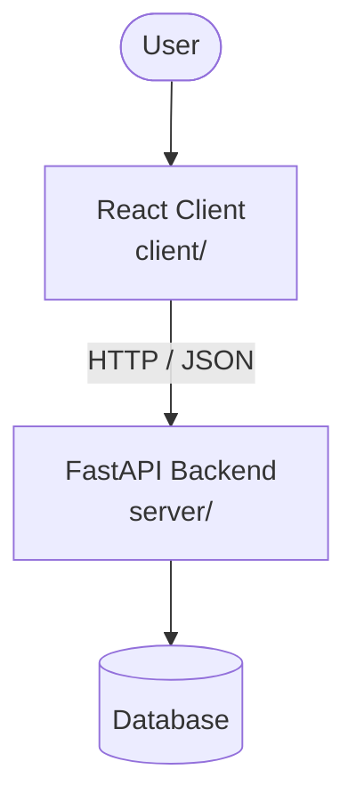

# Architecture

_Auto-generated by the SDLC Assistant from the generated codebase and the approved Feature Spec (latest: NO_SCRUM_ID). Regenerated on each push._

## System Diagram

## Tech Stack
- Not specified

## Backend Modules (server/)
- server/__init__.py
- server/database.py
- server/main.py
- server/models.py
- server/routers/__init__.py
- server/routers/decisions.py
- server/routers/submissions.py
- server/routers/underwriting.py
- server/schemas.py
- server/services/__init__.py
- server/services/checklist_service.py
- server/services/decision_service.py
- server/services/scoring_engine.py
- server/tests/__init__.py
- server/tests/conftest.py
- server/tests/test_decisions.py
- server/tests/test_scoring_checklist.py
- server/tests/test_submissions.py
- server/tests/test_underwriting.py

## Frontend Modules (client/)
- (no client/ files found yet)

## API Endpoints
- POST /calculate-late-fee

## Data Model
- None
